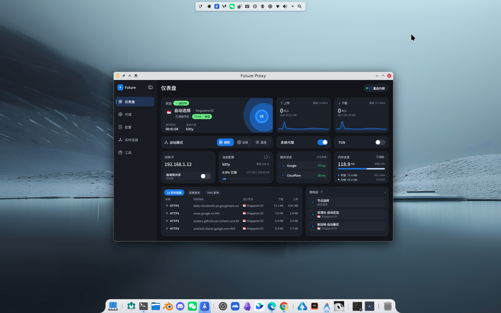

# Future Proxy

新一代超轻量级原生桌面代理客户端（Rust + `eframe` / `egui`），内置 **Mihomo (Clash.Meta)** 高性能内核管理、全矢量自绘 **Cupertino / FlClash Bento Grid** 响应式界面，原生支持 **Linux (RPM)** 与 **Windows 10 / 11 (图形安装向导)**，零 WebView / Electron 依赖。



---

## 📦 下载与安装 (v1.1.0)

前往 [**GitHub Releases (v1.1.0)**](https://github.com/IFtiger-hu-hub/future-proxy/releases/tag/v1.1.0) 下载对应系统安装包：

| 平台 | 安装包文件 | 说明 |
| :--- | :--- | :--- |
| **Windows 10 / 11 (x64)** | [`Future-Proxy-1.1.0-Windows-x86_64-Setup.exe`](https://github.com/IFtiger-hu-hub/future-proxy/releases/tag/v1.1.0) | 6 步图形化安装向导（内置主程序、Mihomo 内核、`wintun.dll` 虚拟网卡驱动与 GeoIP/GeoSite 规则库，自动创建桌面/开始菜单快捷方式并配置开机自启） |
| **Linux (x86_64 RPM)** | [`future-proxy-1.1.0-1.x86_64.rpm`](https://github.com/IFtiger-hu-hub/future-proxy/releases/tag/v1.1.0) | 适用于 openSUSE / Fedora / RHEL 系发行版，内置 `systemd --user` 服务与 `cap_net_admin` 免密 TUN 权限 |

### Linux 快速安装 / 无损替换升级
```bash
sudo rpm -Uvh --replacepkgs --replacefiles future-proxy-1.1.0-1.x86_64.rpm
```

---

## ✨ 核心特性

- **原生矢量 Bento Grid 响应式界面**：
  - 全矢量自绘 Bento 仪表盘（实时上下行速率平滑波形图、一键节点延迟测试与进度反馈、Google / Cloudflare 双路连通性探活、订阅配额进度条、自适应多列节点卡片与策略组抽屉），支持浅色与深色双主题切换。
- **多方式配置与订阅导入**：
  - 同时支持 **HTTP / HTTPS 远程机场订阅链接**（内置系统原生 TLS、证书容错与本地代理通道自动回退重试）、**本地 `.yaml` / `.yml` 配置文件选择**（调用 Windows `GetOpenFileNameW` / Linux `kdialog` & `zenity` 原生文件对话框）以及 **直接拖拽 YAML 文件到窗口任意位置导入**。
- **精细化内存监控与极低资源占用**：
  - 实时区分采集 **GUI 独占物理内存**（Linux `RssAnon` / Windows `K32QueryWorkingSet` 专用工作集，对齐任务管理器）、**含共享显存的总驻留集 (`VmRSS`)**、**Mihomo 内核占用** 与 **宿主系统物理内存**。
  - Windows 端采用全局 `OnceLock` 零拷贝单份字库共享与启动后自动回收临时页；仪表盘与工具页均支持一键 **`[ ↻ 释放 ]`** 闲置内存（调用 `malloc_trim(0)` / `K32EmptyWorkingSet`）。
  - 关闭主窗口回收到系统托盘后自动销毁 OpenGL 渲染上下文并释放显存，后台托盘常驻仅占 **~6 ~ 8 MB**。
- **内核级区域自动优选与容灾（Auto-Failover）**：
  - 自动在订阅中注入 `⚡ 🌍 非港台-自动优选`（自动过滤港/澳/台及信息提示节点，保障 AI 与流媒体服务可用）及各主流地区自动优选组（新加坡 / 日本 / 美国 / 香港）。
- **跨平台深度系统集成（Linux & Windows 10/11）**：
  - **Linux (`linux` 分支)**：支持 `systemd --user` 后台服务守护、RPM 安装阶段自动配置 `cap_net_admin,cap_net_raw` 实现**零密码弹窗开启 TUN 模式**、KDE 系统代理自动配置与 StatusNotifierItem (`ksni`) 系统托盘。
  - **Windows 10 / 11 (`windows` 分支)**：
    - **6 步标准图形安装向导 ([`src/bin/setup.rs`](src/bin/setup.rs))**：支持原生 `SHBrowseForFolderW` 目录选择、`GetDiskFreeSpaceExW` 磁盘空间检测、快捷方式生成与平滑覆盖升级。
    - **双重守护开机自启**：同时写入 Windows `Startup` 启动目录脚本（显式绑定工作目录与 `--tray` 参数）与注册表 `HKCU\...\Run`，兼容笔记本电池供电启动与冷启动托盘重试，并在开机后**自动恢复上次开启的 Windows 系统代理状态**。
    - **内嵌多分辨率图标**：主程序与安装器均内嵌 7 层标准 Windows PE `.rsrc` 图标资源（`16×16` ~ `256×256`），安装后自动调用 `SHChangeNotify` 刷新桌面图标缓存。

---

## 🗂️ 模块架构

| 模块文件 | 职责说明 |
| :--- | :--- |
| [`src/main.rs`](src/main.rs) | 应用生命周期、单实例 IPC 唤醒、后台遥测线程、字体零拷贝初始化与主事件循环 |
| [`src/bin/setup.rs`](src/bin/setup.rs) | Windows 6 步图形化安装向导（内嵌运行时载荷、快捷方式与注册表卸载项配置） |
| [`src/state.rs`](src/state.rs) | 全局状态模型、订阅与配置元数据 (`profiles.json`) 持久化 |
| [`src/core_api.rs`](src/core_api.rs) | Mihomo 内核进程管理、RESTful 控制接口、并发延迟测速与订阅/YAML 拉取解析 |
| [`src/config_patch.rs`](src/config_patch.rs) | 订阅 YAML 规则注入、TUN / 局域网共享配置热补丁与流量配额解析 |
| [`src/platform.rs`](src/platform.rs) | Linux / Windows 跨平台系统托盘、系统代理、开机自启、文件对话框与工作集内存采集 |
| [`src/theme.rs`](src/theme.rs) | 浅色/深色主题色板、高斯阴影、矢量图标绘制与弹性交互按钮组件 |
| [`src/ui_dashboard.rs`](src/ui_dashboard.rs) | 仪表盘页面（状态卡片、上下行速率波形图、内存信息、实时连接表与策略组概览） |
| [`src/ui_proxies.rs`](src/ui_proxies.rs) | 代理节点网格页面、策略组切换、延迟测速动画与订阅/YAML 导入模态框 |
| [`src/ui_tabs.rs`](src/ui_tabs.rs) | 配置管理页、实时连接详情页与工具设置页 |

---

## 🛠️ 开发与打包构建

### 1. 构建 Linux RPM 安装包
```bash
# 运行单元测试
cargo test

# 一键编译 Release 并构建 RPM 安装包（输出至项目根目录 future-proxy-1.1.0-1.x86_64.rpm）
bash packaging/build-rpm.sh
```

### 2. 构建 Windows 10/11 图形安装程序 (`Setup.exe`)
支持在 Linux 环境下通过 MinGW-w64 + Clang/LLD 一键交叉编译生成包含完整载荷与内嵌图标资源的 Windows 安装向导程序：
```bash
# 自动生成 7 层标准 .ico 图标、编译 future-proxy.exe 并打包生成 Future-Proxy-1.1.0-Windows-x86_64-Setup.exe
bash packaging/build-win.sh
```
